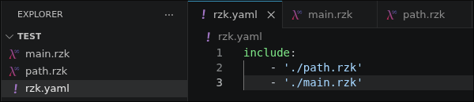

# Improving interactivity and consistency of the Rzk Language Server through on-edit reevaluation.
Author: Vyacheslav Molchanov, BS23-SD-02
Supervisor: Nikolai Kudasov

---
# Rzk
Rzk is an interactive theorem prover (ITP) based on Riehl and Shulman's type theory [1] with shapes.
It is used in some leading math formalization works:
- Formalizing the Infinite-Categorical Yoneda Lemma [2]
- Simplicial HoTT and synthetic infinite-categories [3]

Rzk projects are structured around a main 'rzk.yaml' file, which defines a flat list of included files, alongside all other '.rzk' files containing the actual declarations.

---
# State of Rzk LSP server
- Aware of unsaved changes in IDE, but mostly ignores them and read from disk
- Stores unsaved IDE changes (LSP's `document/didChange` call) in virtual file system (VFS)
- Half of features are buffer-aware (semantic highlighting, formatting, go-to-definition), but are triggered only upon saving 'rzk.yaml'
- The typechecker always reads from the disk
- Typecheck is incremental on the level of separate modules, and its results are cached
- On the level of whole project change in an early module invalidate the entire remainder of 'rzk.yaml'

---
# Problem statement
**Goal:** Improve user expirience through shortening and automating feedback loop.

**Contributions:** Improve project-level cache invalidation, make typechecker aware of unsaved changes in IDE and add edit-trigerred evaluation.

**Evaluation criteria:**
- Typechecking is correct if its result for buffered changes are the same as for 'cold' typechecking from disk.
- Latency for typechecking on large projects should be significantly lower for changes in early modules of 'rzk.yaml' and nearly same for later ones, compared to current Rzk version.

---
# State of the Art: `agda --lsp`
- Agda is a dependently typed programming language and an extension of Martin-Löf’s type theory.
- File-wise: no caching. On request, agda reevaluates the whole file.
- Project-wise: compiled module cache.
- Agda does not evaluate on edit, only on save or by explicit request.

---
# State of the Art: `Lean.Server`
- Lean is a functional programming language and theorem prover built for formalizing mathematics.
- File-wise: directed acyclic graph (DAG). Invalidates only changed declaration and its dependencies.
- Project-wise: compiled module cache.
Only open files and files imported by them are evaluated.
Invalidation is implemented through a file dependency graph.
- On edit: immediate restart on each keystroke.

---
# State of the Art: `coq-lsp`
- `coq-lsp` is a language server for Coq (Roqc) theorem prover.
- File-wise: linear cascade invalidation. It invalidates rest of the file below changed region (including edited declaration).
- Project-wise: compiled module cache.
Invalidation is implemented by monitoring compiled `.vo` files for each module; when a file changes, all corresponding cache is cleared.
- On edit: debouncing and then lazy evaluation, with priority on the current cursor position.

---
# Plan of work
1. Make typechecking aware of unsaved changes
2. Decide on a policy for on-edit project evaluation and implement it
3. Design and implement project-level module dependency graph and cache invalidation
4. Testing and Evaluation

---
# References

1. [A type theory for synthetic ∞-categories](https://arxiv.org/abs/1705.07442)
2. [Formalizing the Infinite-Categorical Yoneda Lemma](https://dl.acm.org/doi/10.1145/3636501.3636945)
3. [Simplicial HoTT and synthetic ∞-categories](https://rzk-lang.github.io/sHoTT/)

---
# Thank you for attention
---
